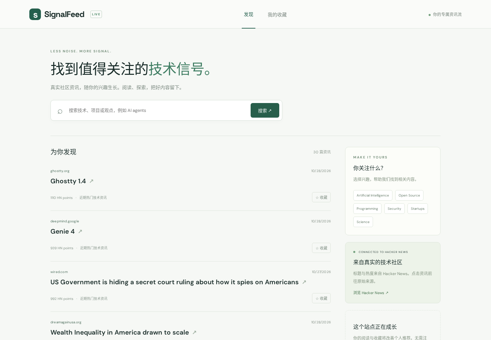
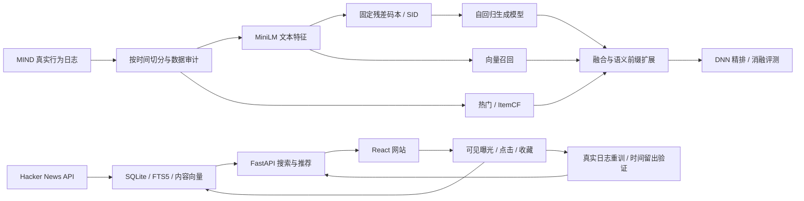

# SignalFeed

一个真实数据驱动、可在单张 24GB GPU 上训练的技术资讯搜索与个性化推荐项目。基于 MiniOneRec 的 SID / SFT / 约束解码能力扩展，加入传统召回、DNN 精排、混合检索和实际反馈服务。



**本机访问：http://127.0.0.1:8765**。网站使用 Hacker News 真实内容；MIND 是独立的历史研究实验。网站没有用离线指标冒充线上效果。

## 运行

代码：`/home/zhuzy/projects/SignalFeed`。运行环境、数据、模型、SQLite 和日志：`/data1/zhuzy/signalfeed`。可通过 `SIGNALFEED_HOME` 更改。

```bash
cd /home/zhuzy/projects/SignalFeed
source scripts/env.sh
# 已安装环境直接运行；首次安装使用 bash scripts/install.sh
signalfeed sync                 # 获取真实 HN 元数据
npm --prefix frontend ci
npm --prefix frontend run build
bash scripts/start.sh           # 后端同时提供构建后的前端
# 停止：bash scripts/stop.sh
```

开发前端：`cd frontend && npm run dev`，API 仍运行在 8765。默认本机绑定，不需要云服务、付费 API 或账号。

## 架构



- `src/signalfeed`：数据、特征、SID 模型、召回评测、DNN、在线服务及日志重训，独立模块与 CLI。
- `frontend`：React + TypeScript，中文界面、英文原文、兴趣选择、搜索、收藏、响应式布局。
- `scripts` / `tests` / `docs`：可复现运行入口、单元/集成测试、实验与来源说明。

### 相对 MiniOneRec 的独立贡献

| 能力 | SignalFeed 的新增实现 |
|---|---|
| 数据与评测 | MIND impression 语义、内部时间验证集、留出评测、候选召回漏失计入分母 |
| 召回互补 | 热门、ItemCF、向量、SID 生成，多路 RRF 与验证集选择的历史长度门控 |
| 新闻冷启动 | 固定码本，新增文章增量编码；生成语义前缀后桶内向量检索 |
| 精排 | 注意力聚合历史兴趣、候选交互和类别特征的 DNN；重训无个性化消融 |
| 服务效率 | 增量内容 embedding 缓存、查询缓存、生成独立进程与超时回退 |
| 产品闭环 | HN 接入、匿名身份、曝光/点击/收藏、反馈重训和原子模型指针 |

没有使用 MiniOneRec GPR 分支中的模拟价值/模拟行为作为实验标签。

## 训练与评测

```bash
source scripts/env.sh
python scripts/download_data.py  # 固定 Recommenders 镜像版本；原 Azure 地址返回 409
signalfeed prepare
signalfeed encode
signalfeed features
signalfeed upstream-smoke --steps 32
signalfeed train --model sid --seed 42
signalfeed train --model ranker --seed 42
python -c 'from signalfeed.ranker import train; train(personal=False)'
signalfeed evaluate --split valid --ranking-limit 2000 --retrieval-limit 300
signalfeed tune-fusion
signalfeed evaluate --seed 42 --retrieval-limit 1000
signalfeed infer --history N33502,N40509 --limit 10  # 使用实际存在的 MIND ID
```

三种子完整流程：`bash scripts/run_experiments.sh`。最终排序评测默认覆盖全部 73,152 个官方 dev impressions；全目录召回评测默认使用固定种子抽取的 1,000 个 impressions，必须和全量排序评测分开解读。`--retrieval-limit 0` 可以运行全量召回评测，时间明显更长。

两种模型配置明确分开：

1. **上游适配验证**：真实 Amazon 子集 + Qwen2.5-0.5B Base + LoRA，训练 SID embeddings，实际使用移植的 MiniOneRec `SidSFTDataset`；保存并重载模型，运行合法 SID 约束生成。
2. **完整 MIND 实验**：约 63 万参数的三层自回归 SID Transformer，全部训练点击目标，单卡 3 epoch。保留 SID 序列 SFT 目标，属于资源受限的小模型配置，**不是 Qwen 全量训练或论文指标复现**。

默认码本为 3×32，SID 对应语义桶，桶内保留所有碰撞文章。`generative` 基线用训练期热度展开桶；`generative_prefix` 使用两层前缀与内容相似度。检索和排序详细协议见 [实验协议](docs/EXPERIMENTS.md)。

模型与报告目录：

- `raw/manifest.json`、`mind/manifest.json`：来源、SHA-256、切分与规模。
- `models/sid-{seed}`、`models/ranker-{seed}`：检查点与训练日志。
- `upstream-smoke/report.json`：Qwen 上游最小验证结果。
- `reports/test-{seed}`：指标及逐条预测；`reports/summary.json`：跨种子均值和标准差。
- `reports/latency.json`：真实 HTTP 性能；`logs`：原始进程输出。

## 网站与反馈

网站默认使用内容兴趣、HN 热度、新鲜度；点击与收藏立即更新匿名用户画像。Hacker News 每 15 分钟同步，失败时保留已有内容。

曝光定义为卡片至少 50% 可见持续 1 秒。请求列表不是曝光；点击和收藏绑定原始请求、条目及位置，事件幂等。浏览器测试使用独立数据库，`SIGNALFEED_TEST_EVENTS=1` 的事件不进入线上统计或训练。清除浏览器 Cookie 会创建新身份。

`GET /api/feed?research=true` 可调用独立进程中的 MIND→HN 生成召回与 DNN 实验，超时 2 秒回退。它是**跨域研究推理**，不代表 HN 上有已验证的收益。默认 feed 不自动使用 MIND 权重。

```bash
signalfeed retrain-online
```

仅消费至少 24 小时成熟的真实曝光，默认最低 1,000 次曝光、50 个点击。样本不足时输出明确状态，不用合成日志补足。训练使用时间留出集，至少 20 个可评测请求且 AUC/NDCG 门槛通过才原子切换线上权重。已有用户收藏与历史不因模型更新丢失。

接口文档：http://127.0.0.1:8765/docs 。主要接口：`/api/feed`、`/api/search?q=`、`/api/events`、`/api/bookmarks`、`/api/interests`、`/api/stats`、`/api/health`。

## 验证

```bash
source scripts/env.sh
pytest -q
npm --prefix frontend run build
# 浏览器用独立测试 DB 和 8766 端口，详见 docs/OPERATIONS.md
cd frontend && npx playwright test
```

[实际运行与实验结果](docs/RESULTS.md) · [运行与故障处理](docs/OPERATIONS.md) · [上游分析](docs/UPSTREAM.md) · [独立贡献及许可证](THIRD_PARTY_NOTICES.md)

## 许可

新增代码 Apache-2.0；保留 MiniOneRec 来源、原许可与修改说明。MIND 仅用于其许可允许的研究实验，不随项目分发，也不作为网站内容。HN 仅保存元数据并链接原站。模型来源与数据下载版本分别记录。
