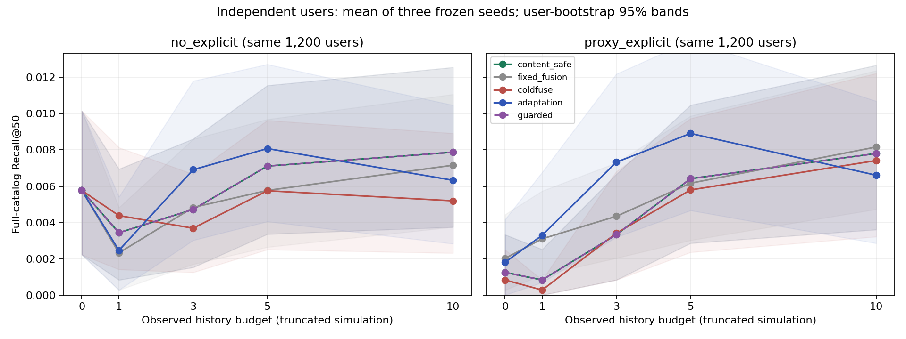
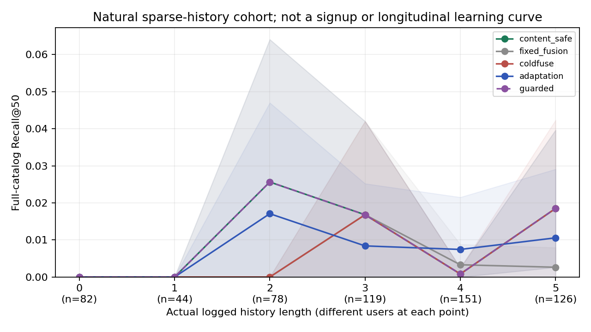

# 冷启动兴趣适应：独立用户实验

本文件从完整逐请求预测生成。解释与部署决定另见 ADAPTATION_ANALYSIS.md；协议见 ADAPTATION_PROTOCOL.md。

原始指标独立复算最大误差：2.220446049250313e-16。参数选择：`{'multi': 1, 'recent': 0.25, 'side': 0.5}`。

## 完整学习曲线

模拟是同一批用户截断；自然曲线各点是不同用户，不是上线连续学习。真实HN新注册用户没有质量样本。

| 场景/历史 | 用户 | 内容回退 | 固定融合 | 旧ColdFuse | 新适应 | 准入回退后 |
|---|---:|---:|---:|---:|---:|---:|
| natural/0 | 82 | 0.000000 | 0.000000 | 0.000000 | 0.000000 | 0.000000 |
| natural/1 | 44 | 0.000000 | 0.000000 | 0.000000 | 0.000000 | 0.000000 |
| natural/1-5 | 518 | 0.012468 | 0.005470 | 0.008607 | 0.009250 | 0.012468 |
| natural/2 | 78 | 0.025641 | 0.000000 | 0.000000 | 0.017094 | 0.025641 |
| natural/3 | 119 | 0.016807 | 0.016807 | 0.016807 | 0.008403 | 0.016807 |
| natural/4 | 151 | 0.000828 | 0.003311 | 0.000828 | 0.007450 | 0.000828 |
| natural/5 | 126 | 0.018519 | 0.002646 | 0.018519 | 0.010582 | 0.018519 |
| natural/all | 600 | 0.010764 | 0.004722 | 0.007431 | 0.007986 | 0.010764 |
| natural_known/0 | 61 | 0.000000 | 0.000000 | 0.000000 | 0.000000 | 0.000000 |
| natural_known/1 | 42 | 0.000000 | 0.000000 | 0.000000 | 0.000000 | 0.000000 |
| natural_known/2 | 68 | 0.014706 | 0.000000 | 0.000000 | 0.004902 | 0.014706 |
| natural_known/3 | 79 | 0.000000 | 0.000000 | 0.000000 | 0.000000 | 0.000000 |
| natural_known/4 | 95 | 0.001316 | 0.003509 | 0.001316 | 0.011842 | 0.001316 |
| natural_known/5 | 90 | 0.022222 | 0.000000 | 0.011111 | 0.000000 | 0.022222 |
| natural_known/all | 435 | 0.007184 | 0.000766 | 0.002586 | 0.003352 | 0.007184 |
| natural_unseen/0 | 21 | 0.000000 | 0.000000 | 0.000000 | 0.000000 | 0.000000 |
| natural_unseen/1 | 2 | 0.000000 | 0.000000 | 0.000000 | 0.000000 | 0.000000 |
| natural_unseen/2 | 10 | 0.100000 | 0.000000 | 0.000000 | 0.100000 | 0.100000 |
| natural_unseen/3 | 40 | 0.050000 | 0.050000 | 0.050000 | 0.025000 | 0.050000 |
| natural_unseen/4 | 56 | 0.000000 | 0.002976 | 0.000000 | 0.000000 | 0.000000 |
| natural_unseen/5 | 36 | 0.009259 | 0.009259 | 0.037037 | 0.037037 | 0.009259 |
| natural_unseen/all | 165 | 0.020202 | 0.015152 | 0.020202 | 0.020202 | 0.020202 |
| no_explicit/0 | 1200 | 0.005770 | 0.005770 | 0.005770 | 0.005770 | 0.005770 |
| no_explicit/1 | 1200 | 0.003438 | 0.002326 | 0.004381 | 0.002465 | 0.003438 |
| no_explicit/10 | 1200 | 0.007875 | 0.007157 | 0.005196 | 0.006330 | 0.007875 |
| no_explicit/3 | 1200 | 0.004722 | 0.004833 | 0.003687 | 0.006910 | 0.004722 |
| no_explicit/5 | 1200 | 0.007111 | 0.005770 | 0.005752 | 0.008076 | 0.007111 |
| proxy_explicit/0 | 1200 | 0.001250 | 0.002020 | 0.000833 | 0.001806 | 0.001250 |
| proxy_explicit/1 | 1200 | 0.000833 | 0.003102 | 0.000278 | 0.003299 | 0.000833 |
| proxy_explicit/10 | 1200 | 0.007806 | 0.008162 | 0.007414 | 0.006608 | 0.007806 |
| proxy_explicit/3 | 1200 | 0.003333 | 0.004344 | 0.003409 | 0.007326 | 0.003333 |
| proxy_explicit/5 | 1200 | 0.006417 | 0.006168 | 0.005798 | 0.008910 | 0.006417 |

## 九项主要配对检验

差值均为对应方法减content_safe，模拟总体等权0/1/3/5；自然按用户等权。先平均同用户种子和预算，再bootstrap/双侧符号翻转；Holm校正九项比较。

| 比较 | 用户 | Recall50差值 | 95%区间 | 原始p | Holm p |
|---|---:|---:|---|---:|---:|
| no_explicit/adaptation | 1200 | +0.000545 | [-0.001128, +0.002316] | 0.552045 | 1.000000 |
| no_explicit/guarded | 1200 | +0.000000 | [+0.000000, +0.000000] | 1.000000 | 1.000000 |
| no_explicit/coldfuse | 1200 | -0.000363 | [-0.001887, +0.001063] | 0.638836 | 1.000000 |
| proxy_explicit/adaptation | 1200 | +0.002377 | [+0.000719, +0.004410] | 0.006699 | 0.060294 |
| proxy_explicit/guarded | 1200 | +0.000000 | [+0.000000, +0.000000] | 1.000000 | 1.000000 |
| proxy_explicit/coldfuse | 1200 | -0.000379 | [-0.001004, +0.000076] | 0.254575 | 1.000000 |
| natural/adaptation | 600 | -0.002778 | [-0.010278, +0.004444] | 0.536346 | 1.000000 |
| natural/guarded | 600 | +0.000000 | [+0.000000, +0.000000] | 1.000000 | 1.000000 |
| natural/coldfuse | 600 | -0.003333 | [-0.010000, +0.002500] | 0.437256 | 1.000000 |

## 独立准入结果

只使用guard用户决定启用；最终test没有选择任何阈值。域限定MIND，不能直接发布为HN获益策略。

| 有效信号组 | 用户 | 验证差值 | Holm p | 启用新适应 |
|---|---:|---:|---:|---|
| prior/0 | 600 | +0.000000 | 1.000000 | False |
| prior/1 | 600 | +0.000417 | 1.000000 | False |
| prior/2-5 | 600 | +0.004742 | 1.000000 | False |
| prior/6+ | 600 | -0.000803 | 1.000000 | False |
| no_prior/0 | 684 | +0.000000 | 1.000000 | False |
| no_prior/1 | 648 | +0.000000 | 1.000000 | False |
| no_prior/2-5 | 1068 | +0.003290 | 1.000000 | False |
| no_prior/6+ | 600 | -0.004791 | 1.000000 | False |

## 独立无结果缓存的推理成本

目录88,053篇；模型/数据/索引初始化2.57秒，随后权重和索引驻留。固定前100模拟及前100自然用户，方法轮转顺序，Torch 2线程、BLAS 1线程，共享CPU主机。下表各格为p50/p95毫秒；全部15方法的原始调用与成本在JSON。

| 场景/历史 | 每方法请求 | 内容回退 | 固定融合 | 旧ColdFuse | 新适应 | 准入回退后 |
|---|---:|---:|---:|---:|---:|---:|
| no_explicit/0 | 100 | 0.94/1.09 | 12.03/12.24 | 13.50/14.00 | 12.04/12.45 | 0.98/1.08 |
| no_explicit/1 | 100 | 12.28/12.64 | 141.21/152.48 | 142.88/149.97 | 175.96/184.60 | 12.49/12.87 |
| no_explicit/3 | 100 | 12.30/12.68 | 144.79/151.92 | 145.75/155.23 | 194.80/203.92 | 12.48/12.88 |
| no_explicit/5 | 100 | 12.29/12.66 | 148.31/158.87 | 151.01/161.08 | 199.73/210.18 | 12.46/12.82 |
| no_explicit/10 | 100 | 12.25/12.64 | 156.75/167.46 | 159.22/166.57 | 212.81/233.97 | 12.46/12.92 |
| proxy_explicit/0 | 100 | 12.12/12.53 | 154.98/164.14 | 155.81/164.73 | 167.54/184.97 | 12.24/12.71 |
| proxy_explicit/1 | 100 | 12.25/12.57 | 157.61/167.62 | 159.12/168.30 | 191.87/198.84 | 12.42/12.80 |
| proxy_explicit/3 | 100 | 12.26/12.56 | 161.74/173.33 | 163.94/173.05 | 212.21/220.64 | 12.41/12.77 |
| proxy_explicit/5 | 100 | 12.23/12.63 | 165.13/173.98 | 165.38/174.44 | 215.44/226.35 | 12.42/12.71 |
| proxy_explicit/10 | 100 | 12.24/12.60 | 175.55/203.74 | 175.16/184.75 | 229.89/236.90 | 12.43/12.86 |
| natural/0 | 12 | 0.97/1.07 | 12.02/12.23 | 13.56/13.90 | 12.00/12.22 | 0.92/1.07 |
| natural/3 | 24 | 12.30/12.65 | 147.38/152.81 | 150.13/154.65 | 198.29/206.00 | 12.45/12.67 |
| natural/5 | 20 | 12.32/12.82 | 153.16/156.21 | 154.43/160.79 | 204.41/212.44 | 12.40/13.14 |
| natural/2 | 15 | 12.34/12.64 | 145.95/196.91 | 145.93/152.21 | 194.04/229.32 | 12.47/13.21 |
| natural/1 | 7 | 12.30/12.64 | 143.27/145.73 | 145.55/152.74 | 178.93/229.52 | 12.43/12.67 |
| natural/4 | 22 | 12.26/12.64 | 149.76/156.02 | 151.08/196.26 | 197.18/203.46 | 12.40/12.72 |

新适应实际生成调用988次，准入回退后0次。此处不包含HTTP、数据库写入或文本编码，不代表HN线上端到端容量。进程峰值RSS 899.6 MiB包含全部基线，不能当作适应模块独占内存。

ItemCF曝光分数复核：冻结评测器按原始重复历史累加曝光分数，但候选策略已对历史去重。原始CSV/JSON仍保留原值；JSON的itemcf_exposure_score_audit另列与候选策略一致的去重AUC/MRR/NDCG。Recall及全部主要检验不变，不能将这项曝光口径修正称为算法提升。

完整15个方法、所有曝光/召回指标、三种子数值、消融差值、预定义分群、候选互补和研究成本见 [JSON](adaptation_results.json) / [CSV](ADAPTATION_METRICS.csv)。曝光稀疏融合分数与密集DNN/内容分数的AUC支持不同，不作主要收益口径。

所有目标保留分母。全目录统一100候选；候选联合覆盖只是多路池的上限诊断。新增目录、用户和可用性信息与首轮不同，只比较本轮配对方法，不能将前后两个数据集直接相减。
